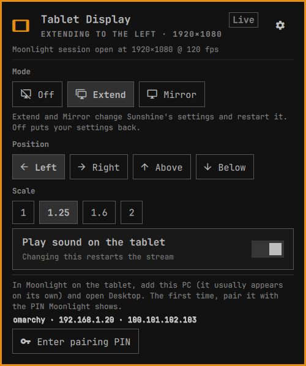

# Tablet Display for Omarchy

Use an Android tablet or an iPad as a second screen for Omarchy, **extended** or
**mirrored**, streamed by [Sunshine](https://github.com/LizardByte/Sunshine) to
[Moonlight](https://moonlight-stream.org).

It's built on game-streaming tech rather than Miracast or AirPlay: hardware
video encoding, up to 120 fps, and low latency. In testing over 5 GHz Wi-Fi,
Moonlight reported about 9 ms of network latency and 10 ms to decode each frame.

Inspired by [omarchy-wireless-display](https://github.com/alchemy/omarchy-wireless-display),
which does the same job over Miracast and AirPlay.



- **Extend** adds the tablet as a new monitor. Hyprland treats it like any other
  display: move windows and workspaces onto it, and the Omarchy bar appears on it.
- **Mirror** shows the monitor you're using on the tablet.
- **Over Wi-Fi or a USB cable.** With USB tethering, latency and frame pacing
  are noticeably better than Wi-Fi; see [Over USB](#over-usb).
- The tablet display always matches the resolution Moonlight asks for, so the
  picture fills the screen with no black bars from mismatched sizes.
- Touch works in Moonlight's trackpad mode, and the S Pen and touchscreen are
  pinned to the tablet's screen. Direct touch is currently misaligned; see
  [Known issues](#known-issues).

Tested on Omarchy with Hyprland 0.56, a Galaxy Tab S9 Ultra, and Intel Iris Xe
(Tiger Lake) graphics. iPad, AMD and NVIDIA should work but haven't been tested.
Reports are welcome.

---

## Contents

1. [Requirements](#requirements)
2. [Install](#install)
3. [Set up Sunshine](#set-up-sunshine)
4. [Hardware encoding](#hardware-encoding)
5. [Set up Moonlight on the tablet](#set-up-moonlight-on-the-tablet)
6. [Use it](#use-it)
7. [Over USB](#over-usb)
8. [Performance](#performance)
9. [What this plugin changes on your system](#what-this-plugin-changes-on-your-system)
10. [Troubleshooting](#troubleshooting)
11. [Known issues](#known-issues)
12. [Remove](#remove)
13. [How it works](#how-it-works)
14. [Command line](#command-line)

---

## Requirements

| What | Notes |
|---|---|
| Omarchy with Hyprland 0.55 or newer | It uses Hyprland's Lua config (`hl.monitor`, `hyprctl eval`) and headless outputs. |
| [Sunshine](https://github.com/LizardByte/Sunshine) | The streaming host. The panel can install it for you; see [Install](#install). |
| A GPU with hardware video encoding | Intel (5th gen / Broadwell and newer), AMD, or NVIDIA. See [Hardware encoding](#hardware-encoding). |
| [Moonlight](https://moonlight-stream.org) on the tablet | Free from the [Play Store](https://play.google.com/store/apps/details?id=com.limelight) or the [App Store](https://apps.apple.com/app/moonlight-game-streaming/id1000551566). |
| A connection between the PC and tablet | A **USB cable with USB tethering** (best), the same 5 or 6 GHz Wi-Fi network, or Tailscale (more latency). |
| `jq`, `inotify-tools` | Already part of Omarchy. |

## Install

1. **Install the plugin**

   ```sh
   omarchy plugin add https://github.com/iwasironman/omarchy-tablet-display.git --enable
   ```

   Choose where the icon goes on the bar when asked. If it doesn't appear, run
   `omarchy restart shell`.

2. **Install Sunshine.** Click the tablet icon in the bar, then **Install Sunshine**.
   A terminal opens and asks for your password once.

   > **Why not `omarchy-install-service-sunshine`?** Omarchy's installer fails on
   > the current Sunshine package with `Unit sunshine.service does not exist`
   > or `Refusing to operate on linked unit file sunshine.service`. The package
   > names its service `app-dev.lizardbyte.app.Sunshine.service`, and
   > `sunshine.service` is only an alias of it. The plugin ships a fixed copy,
   > [`bin/omarchy-tablet-display-install-sunshine`](bin/omarchy-tablet-display-install-sunshine),
   > that does the same steps with the right service name. It uses the same
   > firewall rule comment, so Omarchy's own remover can still undo it.

   The installer:

   - installs the `sunshine` package (`omarchy-pkg-add sunshine`)
   - enables and starts the `app-dev.lizardbyte.app.Sunshine.service` user
     service, so Sunshine starts with your desktop
   - opens Sunshine's ports in `ufw` for private LANs (10/8, 172.16/12,
     192.168/16) and, if present, Tailscale:
     TCP 47984, 47989, 48010; UDP 5353, 47998–48002, 48010
   - adds a **Sunshine Admin** web app to the launcher
   - removes the Hyprland autostart line that Omarchy's installer adds, if an
     earlier run left it there. The service already starts Sunshine, and a
     second copy would fight it for the ports.

   If you'd rather do it by hand:

   ```sh
   omarchy-pkg-add sunshine
   systemctl --user enable --now app-dev.lizardbyte.app.Sunshine.service
   # then open the ports listed above in your firewall
   ```

## Set up Sunshine

You only do this once.

1. **Create the admin login.** Open **Sunshine Admin** from the launcher, the
   gear icon in the panel, or <https://localhost:47990>, and accept the
   self-signed certificate. Sunshine asks you to create a username and password.
   They protect the admin page and pairing.

2. **Tidy the app list (optional).** Sunshine ships three apps: *Desktop*, *Low Res
   Desktop* and *Steam Big Picture*. The plugin only uses **Desktop**. *Low Res
   Desktop* is an X11 `xrandr` example that does nothing on Wayland. Under
   **Applications**, delete the ones you don't want so Moonlight only shows
   *Desktop*.

3. **Leave the encoder settings alone.** Sunshine chooses the hardware encoder
   itself. The plugin sets everything else it needs while it's active and puts
   it back afterwards. See [What this plugin changes](#what-this-plugin-changes-on-your-system).

> **Don't save Sunshine's configuration page while the tablet display is on.**
> The web UI rewrites `sunshine.conf` from scratch and drops the markers the
> plugin uses to restore your settings. Turn the tablet display **Off** first.

## Hardware encoding

Sunshine has to compress the screen into video in real time. A hardware encoder
on the GPU does that in a few milliseconds. Without one, Sunshine falls back to
the CPU, which is far too slow for a desktop at tablet resolution.

### Which driver you need

You normally don't have to install anything: Omarchy's installer already adds the
right driver for your GPU.

| GPU | Encoder Sunshine uses | Package | Installed by Omarchy? | Status |
|---|---|---|---|---|
| Intel HD, UHD, Iris and Iris Xe (5th gen / Broadwell and newer) | VA-API, `iHD` driver (`h264_vaapi`, `hevc_vaapi`) | `intel-media-driver` | Yes, with `libvpl` and `vpl-gpu-rt` | **Tested** on Iris Xe (Tiger Lake). |
| Intel Arc, and Core Ultra graphics | Same VA-API path; also **AV1** (`av1_vaapi`) | `intel-media-driver` | Yes, same script | Should work. Not tested yet. |
| Intel older than Broadwell | VA-API, H.264 only | `libva-intel-driver` | Yes | Expect 1080p at most. |
| AMD (GCN and newer) | VA-API, `radeonsi` driver; AV1 on RX 7000 and newer | `mesa` (it includes the VA-API driver) | Yes, `mesa` is always installed | Should work. Not tested yet. Check with `vainfo` (below). |
| NVIDIA | NVENC; AV1 on RTX 40 and newer | `nvidia-utils` (or `nvidia-580xx-utils` for older cards) | Yes, with the NVIDIA driver | Should work. Not tested yet. Omarchy's Sunshine package is built without CUDA, so each frame takes an extra copy through system memory: a little more CPU and latency. |

`libva-nvidia-driver`, which Omarchy also installs on NVIDIA machines, is only for
video *decoding*; Sunshine doesn't use it.

### Laptops with two GPUs (Intel or AMD plus NVIDIA)

Hyprland normally draws the desktop on the integrated GPU, but Sunshine tries
its encoders in the order NVENC, Vulkan, VA-API, software. It can therefore end
up encoding on the NVIDIA card. Every frame is then
copied from one GPU to the other through system memory. That wakes the NVIDIA
GPU, costs battery, and adds latency for nothing.

Tell Sunshine to stay on the integrated GPU. With the tablet display **Off**, open
Sunshine Admin → **Configuration** → **Advanced** → **Force a Specific Encoder**,
choose **VA-API** and save. That writes this to `sunshine.conf`:

```ini
encoder = vaapi
```

The plugin never touches the `encoder` setting, so it stays in place. Confirm the
choice with the log check in [Check what Sunshine picked](#check-what-sunshine-picked).

### Check that hardware encoding is available

```sh
sudo pacman -S --needed libva-utils
vainfo | grep -E 'Driver|EncSlice'
```

Look for `EncSlice` or `EncSliceLP` lines for `H264` and `HEVC`, for example:

```
vainfo: Driver version: Intel iHD driver for Intel(R) Gen Graphics - 26.3.5 ()
      VAProfileH264Main               :	VAEntrypointEncSliceLP
      VAProfileHEVCMain               :	VAEntrypointEncSliceLP
```

`EncSliceLP` is the GPU's dedicated low-power encoder. It's the fast one, and
Sunshine uses it automatically when it's there.

### Check what Sunshine picked

Start a stream, then:

```sh
journalctl --user -u app-dev.lizardbyte.app.Sunshine -b | grep -E 'Found .* encoder|LP encoding|Creating encoder'
```

You want to see `Found HEVC encoder: hevc_vaapi [vaapi]` (or `nvenc`) and, on
Intel, `Using LP encoding mode`. If you see `libx264` or `libx265`, Sunshine is
encoding on the CPU: install the driver above and restart Sunshine.

These log lines are normal and harmless:

- `Failed to gain CAP_SYS_ADMIN`: the plugin uses the Wayland capture method,
  not KMS, so Sunshine doesn't need that capability.
- CUDA, NVENC or Vulkan "failed" lines while Sunshine probes for encoders at
  startup.

## Set up Moonlight on the tablet

1. Install Moonlight and open it. Your PC usually appears automatically. If it
   doesn't, tap **+** and enter one of the addresses shown at the bottom of the
   panel.
2. Tap the PC. Moonlight shows a **PIN**. On the PC, click **Enter pairing PIN**
   in the panel, type the PIN and give the device a name.
3. Open Moonlight's **Settings** and set:

| Setting | Recommended | Why |
|---|---|---|
| Resolution | **Native** over USB; **1080p** over Wi-Fi | See [Performance](#performance). |
| Frame rate | **60 FPS** | 120 FPS works if your GPU keeps up at your resolution. |
| Video bitrate | 20–40 Mbps at 1080p; 40–80 Mbps at native | Higher looks better but needs better Wi-Fi. |
| Video codec | **HEVC** (H.265) | Better quality than H.264 at the same bitrate. Only use AV1 if your GPU can encode AV1. |
| Frame pacing | **Balanced** or **Prefer smoothest video** | "Lowest latency" can stutter on Wi-Fi. |
| Touch screen as trackpad | **On** | The screen acts like a laptop trackpad. Direct touch (off) is currently misaligned; see [Known issues](#known-issues). |
| Stretch video to full screen | Off | It distorts the picture when the shape doesn't match; see [Performance](#performance). |
| Show performance stats | On while you're tuning | Shows frame rate, network latency and decode time. |
| Play audio on PC | Your choice | The panel's **Play sound on the tablet** toggle controls whether Sunshine sends audio at all. |

## Use it

1. Click the tablet icon in the bar and choose **Extend** or **Mirror**. Sunshine
   restarts with the new settings, which takes about five seconds.
2. On the tablet, open your PC in Moonlight and tap **Desktop**.
3. When you're done, quit the stream in Moonlight (long-press the PC, then
   **Quit app**), then choose **Off** in the panel.

The panel also has:

- **Position**: where the tablet sits relative to your screen. This decides
  which edge the mouse crosses to reach it.
- **Scale**: Hyprland's scale for the tablet. At 1080p, **1.25** suits an 11–15"
  tablet; **1** gives the most space.
- **Play sound on the tablet**.
- **Enter pairing PIN** and the gear icon, which open Sunshine's admin page.
- A **Live** badge while Moonlight is connected, **Live · USB** when it's over
  the cable. If you close Moonlight without **Quit app**, the panel says it's
  disconnected; reconnecting picks up where you left off.

Middle-clicking the bar icon switches between **Extend** and **Off**.

## Over USB

A USB cable gives lower latency and steadier frame pacing than Wi-Fi. Sunshine
and Moonlight work exactly the same; only the address Moonlight connects to
changes.

1. Connect the tablet to the PC with a USB cable.
2. Turn on **USB tethering** on the tablet. On Samsung: **Settings →
   Connections → Mobile Hotspot and Tethering → USB tethering**. On other
   Android tablets it's under **Network & internet → Hotspot & tethering**.
   The tablet's Wi-Fi can be off. On an iPad this is **Personal Hotspot** over
   USB, which needs a cellular model; this hasn't been tested.
3. The panel shows **Tablet connected by USB. In Moonlight, add `<address>`**.
   In Moonlight, tap **+** and add that address. Moonlight recognises it as the
   same, already-paired PC.
4. Choose **Extend** or **Mirror** and open **Desktop** in Moonlight. The panel
   shows **Live · USB** while the stream goes over the cable.

**Firewall.** The Sunshine installer allows Sunshine's ports from all private
address ranges, which is where tethering addresses come from, so the cable
works whichever USB port you use and whatever address the tablet picks. The
panel checks this by reading `ufw`'s rules. If they would block the tablet (for
example, Sunshine was installed some other way), the panel says so and offers
**Allow in firewall**. That opens the same ports the installer would and asks
for your password.

**Your internet stays on Wi-Fi.** A tethered tablet also offers the PC an
internet connection, and NetworkManager prefers wired connections. While the
tablet display is on, the plugin takes the default route off the USB link, so
the PC's internet keeps going through Wi-Fi or Ethernet. It uses
`nmcli device modify <iface> ipv4.never-default yes ipv6.never-default yes`: this
applies to the current connection only, nothing is saved, and it resets when you
unplug the cable. It never applies when the cable is the PC's only connection.
To turn this off: `$CTL set usb-keep-internet false` (see [Command line](#command-line)).

Detected adapters: `rndis_host` (Samsung and most Android tablets), `cdc_ncm` and
`cdc_ether` (other Android tablets), and `ipheth` (iPad). Tested with a Galaxy
Tab S9 Ultra over USB 2 (`rndis_host`).

## Performance

**Over USB, native resolution works even on integrated graphics.** On an Intel
Iris Xe laptop, a Galaxy Tab S9 Ultra runs at its native 2960×1848 at 120 fps
over a USB 2 cable, with steady frame times.

**Over Wi-Fi, start at 1080p.** On the same laptop over 5 GHz Wi-Fi, a
2960×1848 stream held 60 fps while the picture was still, but dropped to about
35 fps whenever something moved (video, scrolling, dragging windows). A moving
picture needs far more data per frame, and the Wi-Fi link couldn't keep up. At
1080p it held 60 fps. The GPU wasn't the limit: it encodes 2960×1848 at over
100 fps.

**Black bars at 1080p.** Most tablets are 16:10 and 1080p is 16:9, so you get
thin bars at the top and bottom. The plugin can't fix this: Moonlight's frame
is 16:9, so a 16:10 desktop would only be shrunk inside it. Moonlight's
**Native** setting uses the tablet's real shape with no bars, if your GPU keeps
up.

**Refresh rate.** The plugin runs the virtual display at twice Moonlight's frame
rate, for example 120 Hz for a 60 fps stream. Sunshine's Wayland capture asks
for a frame and then waits for the display's next refresh. At the same rate as
the stream, that wait halves the frame rate. You don't need to set anything.

**Network.** If Moonlight's stats show dropped frames or high jitter, use
[USB](#over-usb), move the PC to 5 or 6 GHz Wi-Fi or a cable, or lower the
bitrate.

## What this plugin changes on your system

**When you click "Install Sunshine"**, it installs the package, enables the
service, opens firewall ports and adds a launcher entry; see [Install](#install).
Nothing else is installed.

**When you choose Extend or Mirror:**

| What | Where | Undone by Off? |
|---|---|---|
| A headless output called `TABLET-1` (Extend only) | Hyprland, at runtime | Yes, removed |
| A monitor rule for `TABLET-1`, and touch/pen devices mapped to it | Hyprland, at runtime with `hyprctl eval`; **no config file is written** | Yes (gone at the next Hyprland restart anyway) |
| A marked block at the end of `sunshine.conf` with `output_name`, `capture = wlr`, `stream_audio`, `global_prep_cmd` | `~/.config/sunshine/sunshine.conf` | Yes, removed |
| Your own lines for those four keys, commented out with `#omarchy-tablet-display# ` | same file | Yes, restored as they were |
| A small hook script Sunshine calls when Moonlight connects | `~/.local/state/omarchy-tablet-display/sunshine-hook` | Kept (it's harmless) |
| Sunshine is restarted | | Restarted again, or stopped if it wasn't running before |
| Over USB: the USB link stops carrying the PC's default route (`nmcli device modify`, runtime only) | NetworkManager, for the current connection | Resets when the cable is unplugged; nothing is saved |

Your own `global_prep_cmd` entries keep running: the plugin adds its hook after
them. Plugin settings are in
`~/.local/state/omarchy-tablet-display/settings.json`. Session state and a log
are in `$XDG_RUNTIME_DIR/omarchy-tablet-display/`.

If the plugin is removed while it's on, the hook script restores
`sunshine.conf` by itself the next time Moonlight connects, so streaming keeps
working. Running `uninstall` first is still cleaner; see [Remove](#remove).

## Troubleshooting

Start with the built-in diagnostics:

```sh
~/.config/omarchy/plugins/omarchy-tablet-display/bin/omarchy-tablet-display-ctl doctor
```

| Problem | Fix |
|---|---|
| Installing Sunshine fails with `Unit sunshine.service does not exist` | You used Omarchy's installer. Use **Install Sunshine** in the panel instead; see [Install](#install). |
| Moonlight can't connect over USB | Check that USB tethering is on and the panel shows the USB address, and add *that* address in Moonlight. If the panel says the firewall blocks it, click **Allow in firewall**. `doctor` shows the link, its driver and speed, and the firewall verdict. |
| The PC's internet goes through the tablet | The plugin only moves it back while the tablet display is on, and only if Wi-Fi or Ethernet is also connected. Check `doctor`'s `usb link` line. |
| The panel says Moonlight is disconnected, but it's on screen | Moonlight was closed without **Quit app** and then resumed; the panel follows Sunshine's log and updates within a few seconds. |
| Moonlight can't find the PC | Add it by IP address (shown in the panel). Check the firewall rules with `sudo ufw status \| grep omarchy-sunshine`, and that both devices are on the same network. Some routers isolate Wi-Fi clients from each other. |
| Pairing fails | Create the admin login first ([Set up Sunshine](#set-up-sunshine)), then enter the PIN with **Enter pairing PIN**. |
| Black bars on all four sides | Moonlight is still on 720p, its default. Set Resolution to 1080p or Native. The panel shows a warning when the shapes don't match. |
| Low frame rate when things move | Use [USB](#over-usb), or lower Moonlight's resolution; see [Performance](#performance). Check that Sunshine uses the hardware encoder ([Check what Sunshine picked](#check-what-sunshine-picked)). |
| Black screen, or the wrong screen | `journalctl --user -u app-dev.lizardbyte.app.Sunshine -e`. Make sure the display is on **Extend** or **Mirror** *before* connecting. Moonlight's **Quit app**, then reconnect. |
| Moonlight shows Desktop, Low Res Desktop and Steam | Those are Sunshine's default apps; delete the extra ones in Sunshine Admin → Applications. |
| Taps land in the wrong place | That's direct touch; see [Known issues](#known-issues). Turn on **Touch screen as trackpad** in Moonlight. |
| The tablet display vanished after `hyprctl reload` | The plugin re-applies its monitor rule within a few seconds. If Hyprland itself restarted, the plugin turns itself off; choose Extend again. |
| `Failed to gain CAP_SYS_ADMIN` in the log | Harmless; see [Hardware encoding](#hardware-encoding). |

## Known issues

**Direct touch is misaligned.** With Moonlight's **Touch screen as trackpad**
turned off, a tap moves the pointer to the wrong place: horizontally it always
lands at the left edge of the tablet, and when the tablet display is scaled,
vertical positions are off too. Use trackpad mode, which works normally.

What's known so far:

- Moonlight for Android sends direct-touch taps as absolute mouse positions
  (its native touch path is disabled in the app's source). Sunshine replays them
  through its `libvirtualhid-mouse-(absolute)` virtual device.
- With the Sunshine build Omarchy ships (2026.914, the first with
  `libvirtualhid` input), that device never emits a horizontal position, which
  you can confirm by reading its events. Its vertical position is correct when
  the tablet display is at scale 1.
- The same tablet and Moonlight work with direct touch on a niri desktop, so the
  cause is on the PC side: the Sunshine build, or how Sunshine reads a Hyprland
  headless output's layout. It's being investigated.

## Remove

```sh
# 1. Turn everything off, restore sunshine.conf, delete the plugin's state
~/.config/omarchy/plugins/omarchy-tablet-display/bin/omarchy-tablet-display-ctl uninstall

# 2. Remove the plugin
omarchy plugin remove omarchy-tablet-display
```

Sunshine stays installed, because you may use it for other things. To remove it
too:

```sh
systemctl --user disable --now app-dev.lizardbyte.app.Sunshine.service
omarchy-remove-service-sunshine
```

Disable the service first. Omarchy's remover has the same service-name bug as
its installer and would leave it enabled. The remover then removes the package,
closes the firewall ports and deletes the Sunshine Admin web app. Your Sunshine
settings and pairings in `~/.config/sunshine` stay until you delete that
folder.

## How it works

The panel (`Panel.qml`) is a thin front end. It polls
[`bin/omarchy-tablet-display-ctl`](bin/omarchy-tablet-display-ctl) for its state
and sends it commands. The script does all the work:

- **Extend** creates a headless Hyprland output
  (`hyprctl output create headless TABLET-1`), positions and sizes it with a
  runtime `hl.monitor{}` rule, points Sunshine's `output_name` at it, and
  restarts Sunshine. Sunshine reads `output_name` only when it starts.
- **Mirror** points Sunshine at the focused monitor instead.
- When Moonlight starts a session, Sunshine runs the hook, which receives
  `SUNSHINE_CLIENT_WIDTH`, `SUNSHINE_CLIENT_HEIGHT` and `SUNSHINE_CLIENT_FPS`.
  The plugin resizes `TABLET-1` to exactly that size, at twice that frame rate.
- On every poll the script reconciles its state with reality:
  - it re-applies the monitor rule after `hyprctl reload` wipes it
  - it turns itself off cleanly if the output disappears
  - it cleans up `sunshine.conf` after a crash or reboot
  - it maps Sunshine's virtual touchscreen and pen to the streamed output

## Command line

```
CTL=~/.config/omarchy/plugins/omarchy-tablet-display/bin/omarchy-tablet-display-ctl

$CTL extend | mirror [monitor] | off
$CTL set position left|right|above|below
$CTL set scale 1|1.25|1.6|2
$CTL set audio true|false
$CTL set usb-keep-internet true|false   # see Over USB; default true
$CTL firewall              # open Sunshine's ports in ufw (asks for your password)
$CTL state | jq .
$CTL pair | admin          # open Sunshine's PIN page / admin page
$CTL doctor
$CTL uninstall

# For debugging only; the defaults follow Moonlight:
$CTL set resolution auto|<W>x<H>
$CTL set refresh auto|<Hz>
```

Environment overrides:

- `OMARCHY_TABLET_DISPLAY_OUTPUT` (default `TABLET-1`)
- `OMARCHY_TABLET_DISPLAY_DEFAULT_RESOLUTION` (default `2560x1600`, used before Moonlight has ever connected)
- `OMARCHY_TABLET_DISPLAY_SUNSHINE_CONF` (default `~/.config/sunshine/sunshine.conf`)

## Developing

Edit the plugin where the shell loads it, in
`~/.config/omarchy/plugins/omarchy-tablet-display`, not through a symlink: the
shell's file watcher doesn't follow symlinks. After changing a `.qml` file, run
`omarchy restart shell`; the running shell keeps the QML it loaded at startup.
Changes to the control script take effect immediately.

## License

[MIT](LICENSE). Sunshine and Moonlight are separate projects under their own
licenses; this plugin only configures and drives them.
